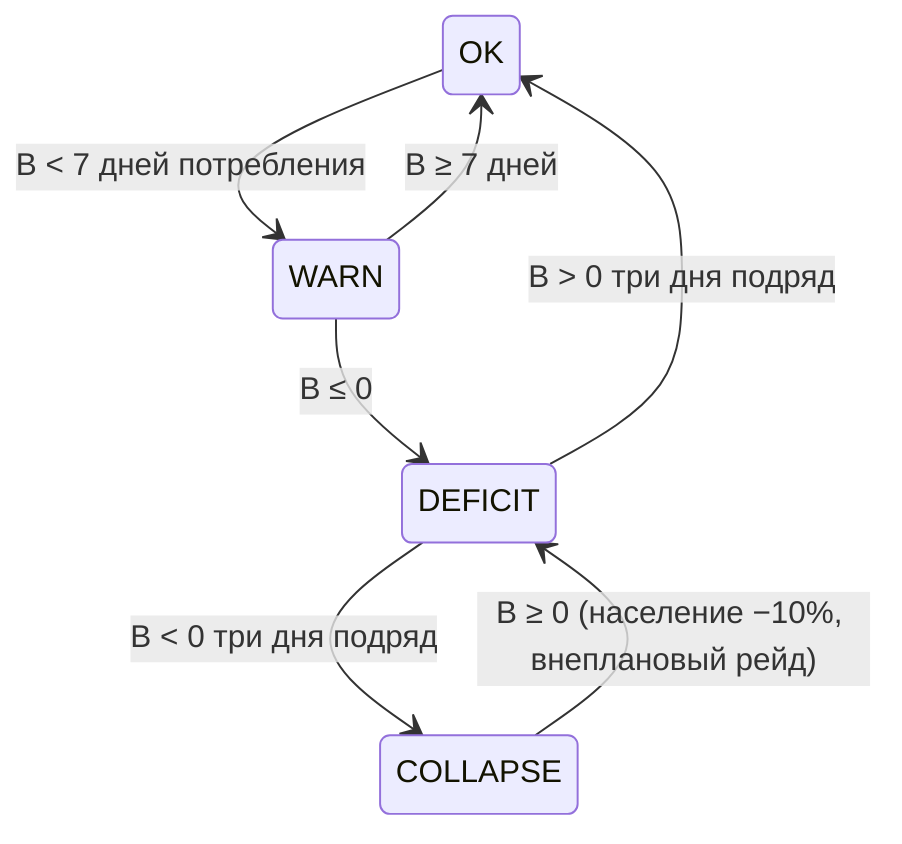

## Экономика и баланс

**Потоки:** город производит ресурсы реестра (K-R2, 2026-10-02: **Layer-1 = 6 товаров** — дерево, железо, еда, ртуть, сера, кристаллы; **Layer-2 = товары** — инструменты, ткань, зелья, провизия, оружие) → тратит на: обслуживание районов (8.3), наём (02-mechanics §3.3), снабжение партии (1 еда/день/юнит, 12.5). Небесные метрики (5.2) не складываются — исключение из замкнутости, декларировано. Старый реестр 5 ресурсов (еда/дерево/камень/железо/оружие) аннулирован в части реестра (K-R2): модель потоков действует; **камень вне реестра** (банк до каменной цепи), **оружие = товар Layer-2** (не ресурс).

> [!note] Пост-пивотный MVP ([[MVP-scope]]): **MVP-подмножество реестра {еда, дерево, железо}** (K-R2: одна схема, 3 товара); ртуть/сера/кристаллы + Layer-2 — Post-MVP/1.0. **Районы и их upkeep — в MVP** (K-M1: «Районы — MVP-ядро», MVP-scope «Город» и «Экономика»; прежде здесь ошибочно числились Post-MVP — grill v3 pass 3).

## Легаси city-economy (не канон)

> [!warning] Легаси city-economy (campaign-building economy) — см. `openspec/changes/archive/2026-10-20-campaign-city-building-economy/legacy-city-economy.md` (путь исправлен 2026-10-27: change заархивирован, ссылка вела в несуществующий каталог — аудит `gdd-economy-audit`); к замене, не канон (T-121 акт 1.2, владелец, 13-я итерация §1.2; срез — D-157).

## Таблица источников/стоков (sources & sinks)

| Ресурс | Источники (sources) | Стоки (sinks) | Сток-одиноразовый? |
|---|---|---|---|
| Еда | фермы (2–3 шт. MVP), огороды | население (`k_pop × pop`/день), партия (1 еда/чел./ход, носитель `economic_turn_processor.gd:183` `MVP_PARTY_MEMBERS × PARTY_FOOD_PER_MEMBER`; исправлено 2026-10-27 по носителю: было «1/переход/юнит», а расход за переход (`supply_system.gd:47`) из прод-пути не вызывается — **T-224**; Q-M75 → (б), D-191), upkeep Аграрного двора (+2/день), тренировка партии (числа — 07-balance «Базовые бойцы MVP»; прежний диапазон «наём 10–35» включал аннулированные позиции: словарь K-M15 и «Ветеран» как покупка — Q-M55/Q-M56, D-189), зимний дефицит (`production_mult` зима **0.4** — Q-M27/Q-M29; прежняя «фермы −20%» — пре-Q-M27 вариант, Q-M66) | нет — постоянный сток |
| Дерево | лесопилка, лесной дозор (район) | постройка (одноразово: cost зданий), тренировка следопыта (15 дерева; «наём лучника» — аннулированный словарь K-M15), upkeep Лесного дозора (+3/день) | да (постройка) + постоянный |
| Камень (вне реестра, K-R2 — банк до каменной цепи) | каменоломня | постройка (одноразово), стены/башни (оборона 12.4) | да (постройка) |
| Железо | шахта + кузница (переработка) | производство оружия (постоянно), тренировка (одноразово, **напрямую** — MVP-код, C-12) |двухзвенный: железо → оружие (тренировка — прямое звено) |
| Оружие (товар Layer-2, K-R2 — не ресурс) | кузница (из железа) | upkeep Военного квартала (+2/день), восстановление снаряжения после рейда; тренировка в MVP-коде потребляет **железо напрямую** (2 железа — Пехотная линия, 02 §3.3; пре-C-12 «10 оружия» аннулировано синком C-12, 2026-10-19; «10–18» включало аннулированного Ветерана) | да (upkeep/восстановление) |

**Исключение — карта (Y4):** узлы дают one-time лут (таблица в 02-mechanics §3.1): конечный одноразовый источник (**в MVP — 5 узлов**: 2 руины, 1 руда, 2 лагеря — MVP-scope «Карта»; прежняя «4–8» устарела, «5+8» — Post-MVP-строка того же файла; Q-M66, D-189), по 1 разу), не создаёт инфляции и не входит в таблицу источников/стоков как непрерывный поток.

**Проверка замкнутости (4 правила):**
1. **У каждого ресурса есть ≥1 постоянный сток** (иначе инфляция-складирование): еда — население/партия; дерево — upkeep+постройка; камень (вне реестра) — постройка (банк, K-R2); железо — переработка в оружие (Layer-2) + тренировка (напрямую, C-12); оружие (Layer-2) — upkeep+восстановление снаряжения. ✅
2. **У каждого стока есть источник** (никаких «нужно 100 чего-то, что не произвести»): все costs тренируемых юнитов ⊆ производимого. ✅
3. **Нет дублирующих ресурсов** (еда ≠ дерево; железо и оружие — два звена одной цепи, не два ресурса-близнеца: железо без кузницы бесполезно, оружие без железа не воспроизводимо). ✅
4. **Баланс к ходу 21:** еда ≈ 0 (ровно в натяг), остальные ≥ 0 (06: якоря ниже). ✅

**Формулы:**
```
production(r) = Σ_zдания output_z × clamp(эффективность, 0.2, 2.5) × race_affinity × season
consumption(r) = k_pop(r) × population + army_size × unit_eat + Σ_upkeep(районы)
B(r, t) = B(r, t−1) + production(r) − consumption(r)
population = min(жильё, floor(продовольствие_в_сутки / k_pop))  # R3 (MVP-scope); k_pop = 0.1/день (K-M12) — ЕДИНАЯ константа, см. строку ниже. Прежняя запись `floor(продовольствие_в_неделю / 0.7)` **эквивалентна** (0.1 = 0.7 / 7); единицы «неделя» в модели нет — календарь: день/ход (Q-M63 → (в), владелец 2026-10-16, Q-A=4, D-189)
```
- `k_pop(еда) = 0.1/день` — **ратифицировано K-M12 (2026-10-02)**, значение в `population.json`, инвариант `test_mvp_invariants.gd` (проверено 2026-10-16). Прежний маркер «[ПРЕДЛОЖЕНИЕ P-8: базовое значение, тюнинг на прототипе]» **снят как устаревший** (Q-M66, D-189): величина ратифицирована, а не предложена. Конверсия день↔ход — `DAYS_PER_SEASON` (Q-M26). Остальные ресурсы для населения = 0.
- Продажа здания: возврат 50% стоимости (анти-эксплойт «продал-купил», 02-mechanics §3.3 EC2).

## Подтверждение носителями (аудит 2026-10-27, `gdd-economy-audit`)

Правило: строка подтверждена, если названа `путь:строка` в `game/` или запись реестра;
нет носителя — открытый `Q-M##`. Пересказа чисел нет ни в одной строке: носитель либо
найден, либо задан вопрос. Состояние секции от этого `deepened` не меняется:
`verified` требует, чтобы расхождений не осталось (`docs/19-gdd-workflow.md`).

| Утверждение | Носитель | Вердикт |
|---|---|---|
| MVP-подмножество {еда, дерево, железо} | `scripts/autoload/resource_registry.gd:26` `CAMPAIGN_MVP_IDS` | подтверждено |
| Камень вне реестра | `resource_registry.gd:21` (Layer-1 = 6 товаров, камня нет), `:26` | подтверждено |
| Ферма — источник еды | `assets/data/campaign_building_catalog.json` `campaign_farm` → `farm_food` outputs `{food: 2}` (2 рабочих) | подтверждено |
| «фермы (2–3 шт. MVP)» как стартовое число | `scripts/campaign/campaign_composition.gd:143` — старт: 1 ферма `output_day {food: 1.0}` | расхождение: «2–3» — намерение, носитель даёт 1 ферму с вдвое меньшей отдачей, чем рецепт каталога; якорь пересчёта — **Q-M91** |
| Огороды как источник еды | — (в campaign-каталоге только `campaign_farm`) | нет носителя → **Q-M110** |
| Население: `k_pop × pop`/день, `k_pop = 0.1` | `data/config/balance/population.json` `k_pop_per_day`; инвариант `game/tests/balance/test_mvp_invariants.gd:43` | подтверждено |
| Та же константа вторым носителем | `scripts/campaign/settlement_processor.gd:33` `const K_POP = 0.1` | два носителя одной величины (конфиг + hardcoded дефолт) — расхождение по форме, значение совпадает |
| Партия: 1 еда/чел./ход | `scripts/economy/economic_turn_processor.gd:12-13, 183` (2 члена × 1 еда, пополнение из города `:174-180`) | подтверждено (после правки строки выше) |
| Расход партии за переход | `scripts/campaign/supply_system.gd:47` `consume_for_travel()` — вызывается только из тестов | мёртвый писатель → **T-224** |
| Upkeep районов: +2 еда, +3 дерева, +5 еды +2 оружия | — (у 5 campaign-зданий `upkeep: {}`; сущности «район-здание» нет, канон — 7 групп `settlement_processor.gd:27`) | нет носителя → **Q-M105** |
| Лесной дозор как источник дерева | — (тот же слой 7 групп, источника `wood` в данных нет) | нет носителя → **Q-M105** |
| Зимний `production_mult` = 0.4 | `scripts/systems/world_seasons.gd:23` | подтверждено |
| Стройка — одноразовый сток дерева/железа | `campaign_building_catalog.json` `costs`: farm `{wood:4}`, sawmill `{wood:5}`, mine `{wood:6}`, barracks `{wood:8, iron:2}` | подтверждено |
| Железо → оружие через кузницу | — (в campaign-каталоге кузницы нет; `weapon` вне `CAMPAIGN_MVP_IDS`) | нет носителя → **Q-M106** |
| Тренировка партии (числа 07-balance) | `campaign_building_catalog.json` `training: []` у всех 5 зданий → `campaign_training_service.gd:63-74` нечего валидировать | расхождение: сервис и тесты (`test_campaign_training_service.gd:26`) готовы, данных нет → **Q-M107** |
| «2 железа — Пехотная линия» | `docs/07-balance.md:68` (текст), в данных — нет | нет носителя → **Q-M107** |
| Кап урона рейда: еда ≤40%, железо/оружие ≤30% | `data/config/balance/raids.json` `loss_caps {food:0.4, wood:0.3, iron:0.3}` | частично: кап дерева 0.3 в тексте не назван, «оружие ≤30%» — носителя нет (оружия в MVP нет) → **Q-M106** |
| SM дефицита OK/WARN/DEFICIT, WARN = 7 дней, производство 25% | `scripts/campaign/settlement_processor.gd:18-19, 39, 51, 165`; `population.json` `deficit_production_factor: 0.25` | подтверждено |
| COLLAPSE (население −10%, внеплановый рейд) | `settlement_processor.gd:20, 180` — «Post-MVP, в MVP-SM нет» | подтверждено как Post-MVP (в диаграмме помечено) |
| Якорь «ход ≈7 — первый рейд (floor, tutorial)» | `raids.json` `directives.first_raid {turn:7, type:"floor", tier:"light", composition:"tutorial"}` | подтверждено |
| Якорь «≤21 — финальный рейд» | `raids.json` `directives.final_raid {turn:21}` | подтверждено |
| Якорь «к ходу 21 еда ≈ 0 (в натяг)» | `data/config/balance/campaign.json` `start_state.resources.food = 600` + `test_mvp_invariants.gd:29` — «600 = минимум без DEFICIT» | расхождение: носитель калибрует обратное (без дефицита); пересчёт — **Q-M91** |
| Якоря фаз 2/3 («должен иметь кузницу», «проверка Военного квартала») | — (`victory_assessment()` = `final_raid_repelled`, `campaign_composition.gd:869-878`) | нет носителя → **Q-M108** |
| «Победа только при полной сети (5 ролей)» | там же: сеть ролей в условие победы не входит | расхождение → **Q-M108** |
| Инвариант «эффективность зданий clamp [0.2; 2.5]» | `population.json` `building_efficiency_clamp` — читателя в `game/scripts` нет; код: `production_chain.gd:14` `minf(ratio, 1.0)` | писатель без читателя, верх 1.0 против 2.5 → **Q-M109** |
| Инвариант «производство ≥ потребление, иначе SM дефицита» — тест | `game/tests/campaign/test_settlement_processor.gd:43-44` (`sm["food"]["state"] == "DEFICIT"`), `:79-82` (DEFICIT→OK за три дня) | подтверждено |
| Инвариант «к ходу 21 оборона ≥ крупного рейда при полной сети» — тест | `game/tests/balance/test_t041_anchors.gd:119-121` (`final_raid_repelled`), `game/tests/balance/test_campaign_city_balance_fixture.gd:74` (`day21_defense == 4`) | частично: якорь реального рейда есть, «полной сети» нет → **Q-M108** |
| Продажа здания: возврат 50% | — (`grep sell/refund` по `scripts/city`, `scripts/world` — носителя нет) | нет носителя → **Q-M105** (тот же слой «районы/сервисы») |
| Секция «Легаси city-economy (не канон)» | `openspec/changes/archive/2026-10-20-campaign-city-building-economy/legacy-city-economy.md` (носитель легаси, T-121 акт 1.2, срез D-157) | подтверждено как легаси-пометка; в банк не переносится (банк — зона без гейта, `docs/bank/`). Ссылка вела в неархивированный путь — исправлено |
| 7 районов = 7 канонических групп | `scripts/campaign/settlement_processor.gd:27-31`; `assets/data/mvp_catalog.json` `groups` | подтверждено, но имена в двух написаниях («Земледельцы **и** Пивовары» против «Земледельцы **&** Пивовары») → **T-225** |

**Итог прогона** (числа пересняты скриптом по таблице, а не с памяти агента). В таблице
30 строк: **14** подтверждены носителем, **7** не имеют носителя, **4** — прямые
расхождения «документ против кода», **2** частичных (формула есть — чисел нет; якорь
есть — «полной сети» нет), **3** расхождения по форме (одну величину держат два
носителя; мёртвый писатель; писатель без читателя). Заведено вопросов **Q-M105…Q-M110**
и тикетов **T-224**, **T-225**, добавлен риск **R-2**.

Открытые вопросы реестра по машинной мере: **13 → 23**. Рост не равен числу новых
строк: +6 — это Q-M105…Q-M110, ещё **+4** проявились потому, что счётчик перестал
считать закрытыми строки, где слово «закрыт» стоит в прозе («тикет закрыт
2026-10-21», «останется списком, который никто не смеет закрыть»), а не в статусе.
Номеров-дублей в `docs/QUESTIONS.md` — **13** (закрытие записывали новой строкой,
оставляя живую «открытую»): заведено **T-226**.

Секция остаётся `deepened`: до закрытия Q-M105…Q-M110 переход к `verified` невозможен
(требует `D-###` и нуля расхождений), а правка чисел — решение владельца, не агента.

## SM дефицита (per resource)


Последствия: WARN — жёлтый индикатор + хроника; DEFICIT — настроение − (02g; отдельной шкалы морали нет — K-M14), производство 25% (12.2); COLLAPSE — население −10%, внеплановый рейд (**в MVP-SM нет**: `settlement_processor.gd:20`, `:180`; `population.json` `collapse.note` = Post-MVP) (per-ресурсный кап: еда ≤40%/день, железо/оружие ≤30% — Q-M58 → (в), D-189; 02-mechanics §3.8).

## Четыре рычага — без изменений

1. Убывающая доходность районов: 25/18/12/7/3 % (8.5).
2. Обслуживание: Аграрный двор +2 еда/день; Военный квартал +5 еды и +2 оружия/день; Лесной дозор +3 дерева/день (8.3).
3. Уязвимость: район = приоритет рейда (+15% для Военного квартала, 8.3); разрушение → destruction_penalty (−25% военное производство / −30% разведка).
4. Культурное напряжение: конфликт застройки (6.2 штрафы) лечится сервисами (таверна, храм — 7.2).

## Якоря баланса кампании (таблица для тюнинга)

| Ход | Событие (K-R3: угрозы — директивы, не календарь) | Экономический якорь |
|---|---|---|
| 1–6 | выживание | еда в дефиците: фермы 2–3 против населения старта |
| ≈7 | первый рейд (floor-директива, tutorial-тир, K-R3) | **остаток** еды после лёгкого рейда ≈ 40–50% стартового запаса — норма (это **остаток запаса**, а не кап урона: кап per-ресурс за рейд — [[07-balance#5. Угрозы и рейды|07-balance §5]]; разведение формулировок — grill v3 pass 4) |
| 8–13 | фаза 2 (железо) | игрок должен иметь кузницу, иначе провал фазы |
| 14–20 | фаза 3 (оружие/район) | проверка Военного квартала; один район должен быть в опасности |
| ≤21 | финальный рейд (floor-директива, тир max, K-R3) | победа возможна только при полной сети (все 5 ролей 12.1) |

**CR-якоря врагов карты [ПРЕДЛОЖЕНИЕ P-2]:** фаза 1 (ходы 1–6) — CR ¼–1; фаза 2 (7–13) — CR 1–2; фаза 3 (14–20) — CR 2–4; ход 21 — босс (CR — [[07-balance#5. Угрозы и рейды]]; партия 4–5 персонажей 3–5 уровней).

## Экономические инварианты (что должно сходиться всегда)

- производство еды ≥ потребление (население + партия + upkeep районов) — иначе SM дефицита;
- лимит армии — [[07-balance#5. Угрозы и рейды]] (12.5);
- эффективность зданий clamp [0.2; 2.5] (6.3);
- к ходу 21 суммарная сила обороны (12.1) ≥ сила крупного рейда при полной сети и < силы рейда при любой сломанной роли — «проверка всей сети» (3.1).

**EC (системные):**
1. **Игрок складировщик** (копит всё, не тренирует, не строит) → инфляции нет (ресурсы не плодятся), но видимость = 1 (мин.) → рейды слабые; стагнация безопасна, но к ходу 21 сеть неполная → крупный рейд проигран по инварианту. Экономика сама наказывает бездействие финалом.
2. **Игрок сносит всё и перестраивает** (cash-out) → возврат 50% < стоимость: перестройка стоит дороже; двойная постройка невозможна (1 клетка = 1 здание).
3. **Рейд во время DEFICIT** → последствия ×1.5 (сложное), но per-ресурсный кап (еда ≤40%, железо/оружие ≤30% — Q-M58 → (в), D-189) и COLLAPSE-кап не дают снежкока; хроника объясняет: «пришли, когда вам было хуже всего».

#open-question: точные N тиков/день (Q6) — на бумажный прототип. (k_pop/P-8 из этой строки снят: величина ратифицирована K-M12 — Q-M66, D-189.)

## Балансировочные рычаги (17, перенос из GDD.md v2.1) [КАНОН]

1. **Убывающая доходность** — одинаковые районы не складываются линейно ([[02e2-city#8.5. Убывающая доходность [КАНОН]|02e 8.5]]).
2. **Обслуживание районов** — район потребляет еду, материалы, рабочих, безопасность (мораль как потребляемая шкала аннулирована — K-M14; давление на настроение города — 02g). Большой район — обязательства, а не только бафф.
3. **Уязвимость** — крупный район легче обнаружить, дороже восстанавливать, при разрушении отключает несколько узлов, приоритетная цель рейдов. Выбор игрока: централизация (мощно, рискованно) vs децентрализация (слабее, устойчивее).
4. **Культурное напряжение** — конфликт культур и типов застройки (военный орочий квартал у эльфийского святилища → unrest). Сервисы лечат: таверна, храм, рынок, баня, общее собрание, праздник.

*Источник: 005§36*
